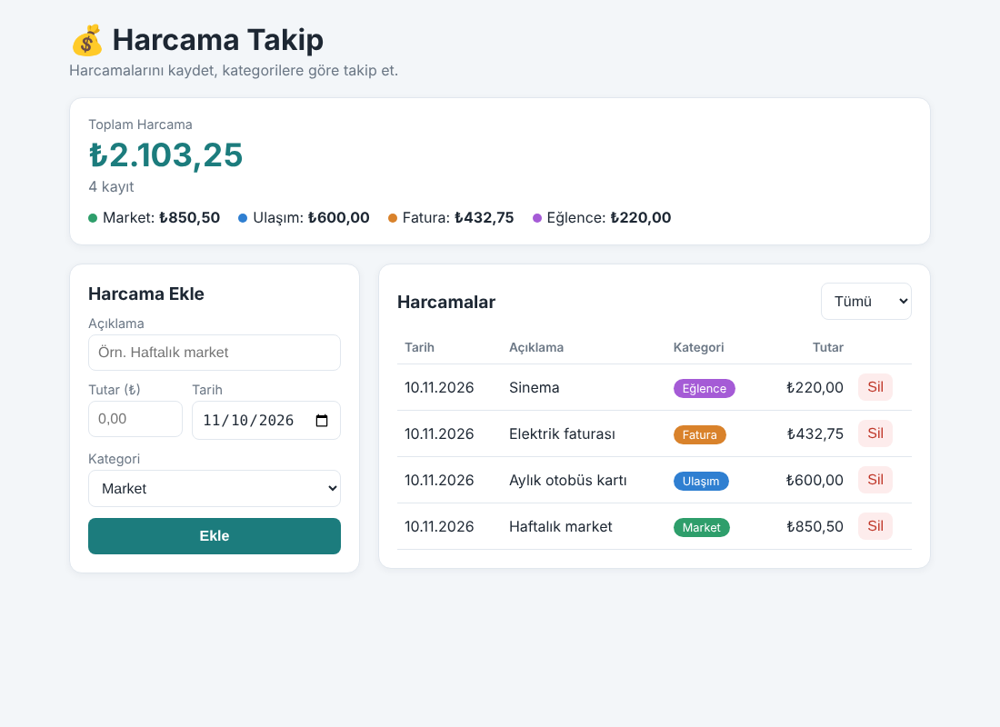

# 💰 Harcama Takip

Günlük harcamaları kaydetmeye, kategorilere göre takip etmeye ve toplam tutarı görmeye yarayan basit bir web uygulaması. Veriler tarayıcının **LocalStorage** alanında saklanır, sayfa yenilense de kaybolmaz.

🔗 **Canlı link:** (Netlify/Vercel linkini buraya yapıştır)
📂 **GitHub:** (depo linkini buraya yapıştır)



## Özellikler
- Açıklama, tutar, tarih ve kategori ile harcama ekleme (boş veya hatalı girişte uyarı)
- Kategoriye göre renkli rozetler
- Üstte toplam tutarı ve kategori bazlı dağılımı gösteren özet kartı
- Kategoriye göre filtreleme
- Harcama silme
- LocalStorage ile kalıcı kayıt
- Mobil uyumlu (responsive) tasarım

## Kullanılan Teknolojiler
- React 18 (Vite ile)
- Saf CSS
- LocalStorage (özel `useLocalStorage` hook'u)
- Yayın: Netlify / Vercel

## Kurulum
```bash
git clone <https://github.com/erenay44/harcama_takip.git>
cd harcama-takip
npm install
npm run dev      # geliştirme sunucusu (http://localhost:5173)
npm run build    # yayın için derleme (dist/ klasörü)
```

## Proje Yapısı
```
src/
├── App.jsx                 # ana bileşen, state yönetimi
├── components/
│   ├── ExpenseForm.jsx     # harcama ekleme formu
│   ├── ExpenseTable.jsx    # tablo ve filtre
│   └── SummaryCard.jsx     # toplam ve kategori özeti
├── hooks/useLocalStorage.js
├── data/categories.js      # kategoriler, renkler, TL biçimlendirme
└── styles.css
```

